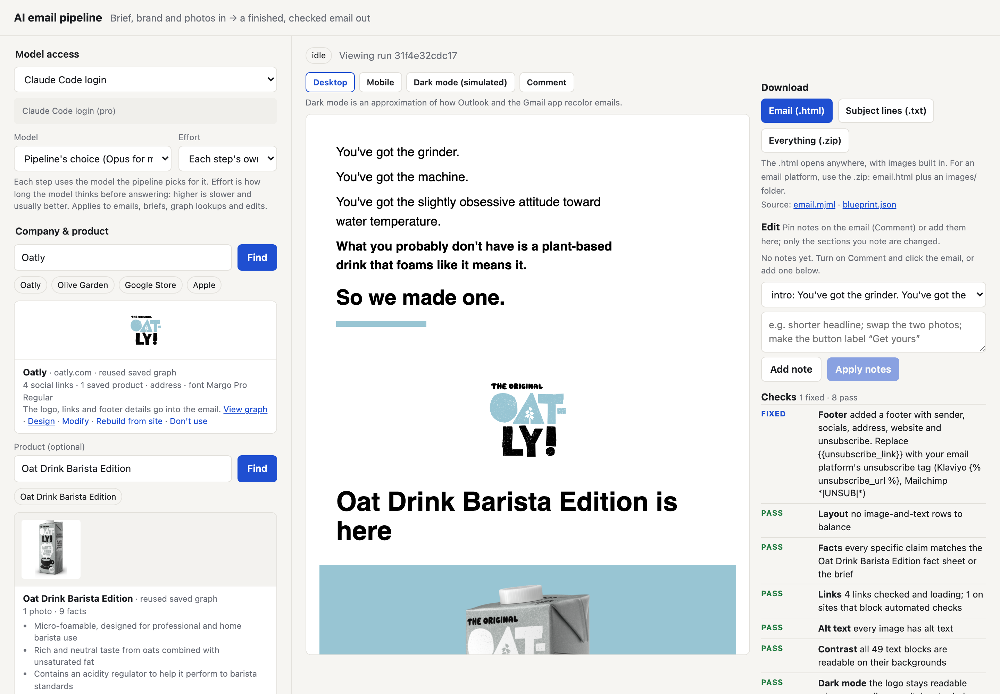
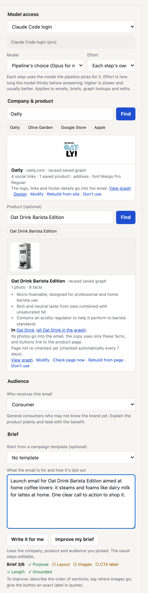
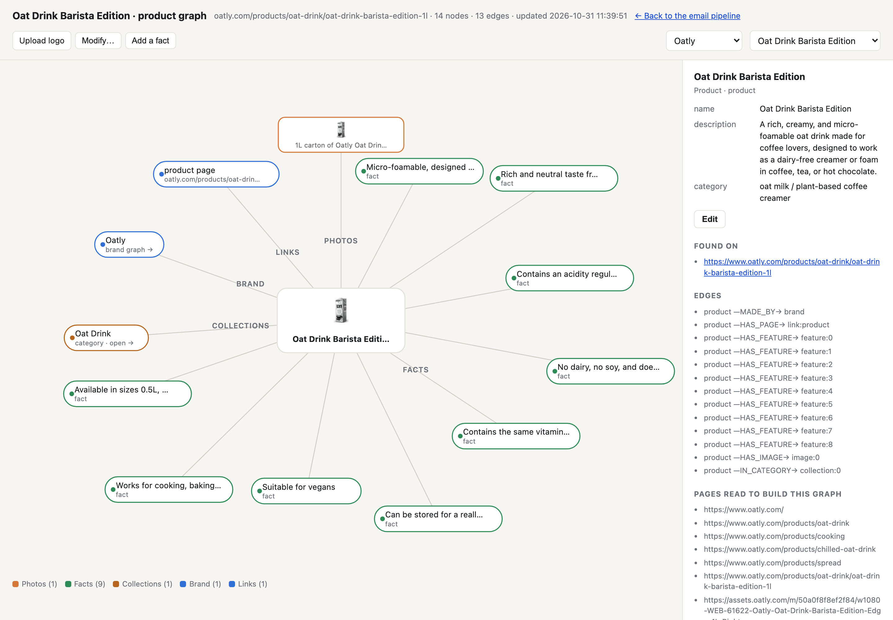

# AI email pipeline

Give it a brief, a brand and a few product photos, and it produces a finished, on-brand marketing email: tested HTML and MJML, five subject-line options and a zip ready for an email platform. Brand and product facts come from knowledge graphs it builds from the brand's own website, and every email is checked against them before you see it.



A finished email, made on a Claude Code login in about 10 minutes, with the checks it passed.

<table>
<tr>
<td width="32%"></td>
<td></td>
</tr>
<tr>
<td>The form, filled from the saved company and product graphs</td>
<td>The product graph the email's facts are checked against</td>
</tr>
</table>

Oatly is a public example brand here; this project isn't affiliated with it.

## How it works

```mermaid
flowchart LR
  UI["Web UI<br/>local/static"] -->|brief, brand, photos| APP["app.py<br/>FastAPI on 127.0.0.1"]
  APP -->|one process per build| BW["brand_worker.py"]
  BW -->|reads the brand's site| KG[("Company and product<br/>knowledge graphs")]
  APP -->|one process per email| W["worker.py"]
  W --> PLAN["Planning agent<br/>sections, copy, CTA"]
  KG -->|facts, photos, links,<br/>palette, voice| PLAN
  PLAN --> ART["Art direction<br/>per section"]
  ART --> DES["MJML design<br/>designer agent"]
  DES --> HTML["mjml → HTML"]
  HTML --> QA["Visual QA<br/>screenshot → edits"]
  QA -.->|re-render, up to 2 rounds| HTML
  QA --> CHK["Post-render checks<br/>facts, links, footer,<br/>contrast, inbox…"]
  KG --> CHK
  CHK --> OUT["Export<br/>email.html · .zip ·<br/>subject lines"]
```



1. **Knowledge graphs.** Type a brand name and `brand_worker.py` finds the official site, reads it (in headless Chromium when the page needs JavaScript), and has the model turn what it finds into a graph: logo, palette, fonts, voice, links, address, collections. Products get their own graphs: price, variants, features and the real product photos. Every fact keeps the page it came from.
2. **Planning.** The brief, the audience and the graph facts go to a planning agent that writes the blueprint: sections in order, copy for each one and the CTA.
3. **Art direction and design.** Each section gets art direction, then a designer agent writes its MJML. The agent renders the section, looks at the result and revises it.
4. **Visual QA.** The whole email is rendered to a screenshot. A critic model reviews the image together with the code and returns structured edits, which are applied with guards (section markers are protected) and the email re-rendered, for up to two rounds. A final pass trims images that crowd the layout.
5. **Checks.** Ten checks run on the finished HTML, fix what they safely can and report the rest (the [table below](#checks-on-every-email)).
6. **Export.** Subject lines are split out, preview text set, and the email exported as one self-contained HTML file or a zip with its images.

## What's in this repo

| Part | What it is | Size |
|---|---|---|
| `local/` | **This app, written for this project:** the web UI, the run and graph workers, the company and product knowledge graphs, the brief writer and its checklist, the ten post-render checks, graph editing and Modify, the two design layers, email import, export, per-run model choice, the Claude Code and ChatGPT CLI adapters (including tool calls for the designer agent), and the bootstrap that runs the engine on one machine | 27 Python modules, ~9,900 lines; UI ~2,500 lines |
| `tests/`, CI | Offline pytest suite for `local/` and a GitHub Actions workflow (ruff and pytest) | 105 tests, ~900 lines |
| Third-party | Email section patterns adapted from Cerberus and Foundation for Emails, email-client support data from caniemail (all MIT, see `local/design/NOTICE.md`), the `mjml` npm package, and the Python libraries in `local/requirements.txt` | |

## Key design decisions

**Facts come from the brand, not the model.** A model writing marketing copy will happily invent a price, a material or a guarantee. Here the product's facts, price and photos come from its knowledge graph, which records the page every fact came from. The planner is told not to add others, and after rendering the **Facts** check makes one model call that compares the copy with the fact sheet, the photos and the brief, rewriting any specific claim none of them supports. Graph changes requested in plain language (Modify) come with an exact quote from the page they came from; the quote is checked against the page text, and a change whose quote isn't found starts unticked with a warning.

**Model access is chosen per run.** Each run, brief or graph job picks **Claude Code login**, **ChatGPT login** or **API keys**, plus a model and effort. On logins every model call is one locked-down CLI run (`claude -p` with no tools, MCP servers or settings; `codex exec` in a read-only sandbox in an empty folder). The CLIs can't take tool definitions, so `llm_backends.py` describes the designer agent's tools in the prompt and parses its tool calls back. **Speed** (`model_routing.py`) moves only the mechanical steps (template picking, image shortlists, MJML validation) to a faster model, recognised by how their prompts open.

**Look at the email, not just the code.** MJML that validates can still look wrong. The designer agent renders each section and revises it, the visual QA loop reviews a screenshot of the whole email alongside its code, and the post-render checks measure the rendered page: text contrast against the actual pixels behind it, logo legibility, column balance, dark-mode visibility.

**A brief is checked before it's used.** A vague brief gives a vague email. The brief checklist (`brief_writer.CHECKS`: purpose, layout, images, an exact CTA label, length, grounded in a company) is one list of patterns, shared by the meter in the UI and by the brief writer, which rewrites a draft (up to twice) until every item the text can fix is met.

**Every check is allowed to fail.** Each post-render check runs on its own. One that throws is reported as skipped and the email still ships, so a flaky link check or a missing browser never costs a finished email.

## Security and data handling

- **Secrets** live only in `local/.env` (git-ignored, created `chmod 600` by `setup.sh`). Nothing in the repo holds a key. API keys are removed from the CLIs' environment so a login run never spends API credit, and `bootstrap.assert_keys_untouched()` stops a run if any imported module changes them.
- **What leaves the machine:**
  - Model calls go to Anthropic, OpenAI or Google, depending on the access you pick (through the `claude` or `codex` CLI on a login). Python can reach a provider's API only when its key is set in `local/.env`, so a backup step can't send an email to a provider you didn't set up.
  - A graph build reads the brand's own public website.
  - The link check requests the links in the email.
  - The optional image and web search reach their providers (Openverse, Wikipedia; Brave and Pexels only with a key).
  - Nothing else is sent anywhere, and there is no telemetry.
- **Network guard.**
  - In generation runs, Python can resolve only localhost and the model APIs whose keys are set (`bootstrap._install_egress_guard`, `egress.py`).
  - Graph builds also allow the hosts the brand's site uses, over public HTTPS only.
  - Every fetch refuses private and loopback addresses, so a link in a brief can't reach internal services.
  - The headless browser is a separate process and can load the fonts and images an email links to.
- **Where data is stored.** Runs, graphs, uploads and settings stay in `local/storage/` (git-ignored). File access is confined to that folder: storage keys and run ids are validated, and paths that resolve outside it are refused.
- **Local only.** The server listens on `127.0.0.1` and has no login, so don't expose it on a network. Claude Code and ChatGPT logins are for your own use; anything other people use needs API keys.
- **CI** runs with read-only repository permissions and never needs a model key: the tests replace model, network, browser and MJML calls with fakes, and fail if anything tries to open a connection.

## Tests and lint

The tests need no model, network or browser, and run in about a second:

```bash
python3.12 -m venv .venv
.venv/bin/pip install -r requirements-dev.txt
.venv/bin/python -m pytest
.venv/bin/ruff check .
```

## Known limits and next steps

- **It places photos, it doesn't make them.** It uses the brand's photos and the ones you upload, and generates no product photography or animation.
- **Facts depend on the site.** The fact check catches unsupported specifics, but only against what the brand's site and your brief say. Check the copy before sending.
- **Tests don't run the model-driven pipeline.** They cover the app's own logic offline. Next step: a recorded end-to-end run with model responses replayed from fixtures.
- **Rate limits.** Up to `MAX_PARALLEL_RUNS` (default 2) emails generate at once, and Claude Code and ChatGPT logins have rate limits, so raising it can make runs fail.
- **A dependency deprecation.** `brand_graph._analyze` uses Pillow's `getdata()`, which Pillow 14 (October 2027) removes.

---

# Using the app

Each run takes about 10–15 minutes. When it finishes:

| Download | Contents |
|---|---|
| **Email (.html)** | The email alone, images embedded, opens anywhere |
| **Subject lines (.txt)** | Five subject + preheader options |
| **Everything (.zip)** | `email.html` + `images/` + `subject-lines.txt` + `email.mjml`. Upload this to an email platform |

Every run is kept in `local/storage/runs/<run-id>/` and listed under **Past runs**. The email's hidden inbox preview text uses preheader option 1. Replace the CTA's placeholder link before sending (the UI flags it).

## Audience and brief

**Audience** is who receives the email. Pick one of the presets (Consumer, New subscribers, Existing customers, Loyal / VIP, Lapsed, Cart abandoners, Business buyers) or **Custom…** with your own name and description. The name and description go to the planning step under TARGET AUDIENCE, which uses them to choose the angle, structure and tone; the designer and copywriter also write for that audience. (The backend's pharma words HCP, Patient, DTP and Payer additionally switch on audience-specific brand rules and safety-information formats; consumer audiences don't.)

**Brief** is plain, editable text: what the email is for and how it's laid out. **Write it for me** drafts one from your idea in the box (or from nothing) using the chosen company, product, audience and uploaded images; **Improve my brief** keeps your intent and wording and fills in the layout, image placement and CTA. Both use only facts in the graphs, and **Undo** restores what you had. The brief is still yours to edit before generating. The meter under the box (Purpose, Layout, Images, CTA label, Length, Grounded) uses the same rules the writer is held to (`brief_writer.CHECKS`): a written or improved brief, and every email of a sequence, is checked against them and rewritten (up to twice) until every item the text can fix is met; the note under the box says whether they all are. Grounded is met by picking a company, not by the text.

**Images** are photos you add to the run: drop them on the box, click it to choose, or paste one; each gets a role (hero, product, lifestyle…) and a description of what it shows, which the planner and designer use to place it, the alt text is based on, and the fact check counts as a source. WebP files are converted to PNG/JPG. **Search for images…** finds more (`image_search.py`, run in the brand worker): **Anywhere on the web** runs a web search (Claude's web search on a Claude login, the API's on API keys, Brave if set, Wikipedia) and collects the photos on the pages it finds, share images first; **The brand's website** lists the photos saved in its product graphs and the images on its best-matching pages; **Openverse** searches Creative Commons photos (and **Pexels** with `PEXELS_API_KEY`). Click a result to add it: it is downloaded, checked, resized to at most 2000px, and added like a dropped file with its description and source filled in. Any image added without a description gets one from the model (5–10s each, one at a time): what it shows, naming the product and colour when it clearly is the chosen product, plus the role it suits (the first image stays the hero). Anything you type first is kept.

The whole form (brief, audience, chosen company and product, brand style edits, model access) is saved in your browser as you work and comes back after a refresh. Uploaded images are not kept. **Start over**, under the Generate button, clears it.

## Company knowledge graphs

Under **Brand → Company**, type a brand name or website (`Allbirds`, `allbirds.com`) and click **Find**.

- **First search for a company** builds its graph (about a minute): the model maps the name to the official website, the site is fetched (rendered in headless Chromium when the header is built by JavaScript), and logo candidates, CSS colors, fonts, social links, footer text and structured data are collected. The model then picks the real logo from the candidate images and fills in name, tagline, palette roles, font, voice, style rules, address, key links and product collections.
- **Later searches** for the same name, domain or an earlier search term reuse the saved graph instantly. **Rebuild from site** refreshes it.
- **In a run**, the graph fills the brand form and adds the logo to the email (the variant that reads on the email's background; one-color marks also get a reversed version), sends call-to-action links to the real shop page, and puts social links, the sender's name and address and the website in the footer. Form edits still win for colors, fonts, voice and rules.

**Products.** Once a brand is chosen, **Product** takes a product name (`Tree Runner`) or its page link. The first search finds the page (the store's own product search, the site's links, then its sitemap), reads its structured product data, price, variants and text, and the model keeps the real product photos and the facts the page states. The product graph is saved under its brand and the brand graph gets a `SELLS` link to it; later searches by name or link reuse it. In a run, the product's photos go into the email (the first as the hero, unless you upload a hero yourself), its facts and price are added to the brief with an instruction not to invent others, and its buttons link to the product page. Logo, palette, voice and footer still come from the brand.

Each product is placed under its **category** in the brand graph (Google Store → Phones → Pixel 11 Pro) instead of hanging straight off the company: the model picks the one collection that is the product's own category from the brand's menu, and promotional collections (Offers, New Arrivals, Bestsellers…) are linked as *featured in* only when their page really lists the product (judged from the page's main content, not its menus; pages are fetched slowly, since stores rate-limit). This happens after every product build (`place_products`, or `brand_worker.py --place <brand>` for all of a brand's products); the product graph gets the same Collection nodes, the product card shows *In Phones · also featured in Offers*, and emails may add a "See all Phones" link to the category page. Rebuilding the brand keeps products under their categories, matched by name.

Each category is also a graph of its own (`/graph/<brand>/collection/<category>`): double-click *Phones* in the brand graph, or pick it under *Categories* in the menu, to see every product in it with its photo and price; it fills up as more products are built. Products that have a category appear only inside it, not on the brand graph itself (clicking *Phones* once lists them in the side panel). Moving between brand, category and product graphs stays on the page: it zooms into the node you open and back out of it when you go up (the browser's back button works too), and there is no animation when the system asks for reduced motion.

When the page found is a shop, buy or configurator page (e.g. `apple.com/shop/buy-iphone/iphone-18-pro`), which lists only purchase options, the build also reads the product's own overview page (a linked "Overview"/"Learn more" page, or the product's slug at the site root, e.g. `apple.com/iphone-18-pro/`) and merges its features and photos, features first. Photos are read from `` and `<picture><source>` tags. A product photo on a plain background is cropped to the product (with a margin) when the product fills less than 60% of the frame, so it doesn't look tiny in an email; photos that are almost empty frames (an intro-animation still, a blank backdrop) are skipped.

Each logo is classed by the backgrounds it reads on, from how much of its ink stands out (2:1 or better) on white and on black: a logo that reads on both, like Google's four-colour G, is usable anywhere; one whose light lettering only reads on dark (Dota 2) gets a dark band in emails.

Graphs live in `local/storage/brands/<domain>/`: `graph.json` (nodes such as Company, Logo, Color, Font, Link, SocialProfile, Address, Product, each with the page it came from, plus `HAS_LOGO`/`SELLS`/… edges) and the logo PNGs. Product graphs are `products/<product>.json` next to it (nodes Product, Brand, Offer, ProductImage, Feature, Variant, Link) with their photos in `products/<product>/`. Open any graph at `/graph/<brand>` or `/graph/<brand>/<product>` (also **View graph** on each card) to see its nodes, edges and the page each fact came from. Building runs in its own process (`brand_worker.py`) that lets through only the hosts the company's site uses; generation runs keep the normal network allowlist.

**Editing graphs.** On a graph page you can edit or delete any fact, **Add a fact** (rules, colors, links, product features…), **Upload logo** (PNG, JPG, WebP or SVG; one-color logos also get a reversed copy) and, for brands, **Upload brand guide (PDF)**, which reads colors, font, voice, tagline and rules out of the guide. Everything you change is marked *edited by you* and survives **Rebuild**; facts you delete stay deleted. Rebuilds match nodes by content as well as id, so a variant you added that the site now lists too isn't kept twice, and a deleted fact doesn't come back under a new id. A product can have its own colors, font and voice, which replace the brand's in emails about it, and its own logo, used as set by **Logo in emails** on the product card: *Brand logo only* (default; right for most products), *Brand logo in header + product logo above the product* (a product mark inside a brand), or *Product logo replaces the brand logo* (products run as their own brand, like Dota 2 under Valve). If the designer leaves a logo out, the logo check adds it, brand logo first. A logo upload whose artwork touches one edge while the opposite side has empty space is flagged as probably cut off.

**Modify.** On the brand or product card (or **Modify…** on a graph page), type what to add, change or remove, e.g. *add the care instructions*, *add their sustainability facts*, *remove the TikTok link*, *the accent color is #0A7B55*. It reads the graph's own page, any link you paste, and the site's pages that best match your words (menu links, then the sitemap), and proposes changes, each with the page and an exact quote it came from (`graph_modify.py`). Quotes are checked against the page text; one that isn't found is shown unticked with a warning. Pages are read the way a shopper sees them, including option swatches (with their colors) and image alt text, which plain page text leaves out (`page_reader.py`; product graphs are built the same way, so a product's colors come with their hex codes). Tick **Also search the web**, or write *do a web search*, to look beyond the brand's site (`web_search.py`): Claude Code's web search on a Claude login, the API's web search tool on API keys, Brave if `BRAVE_SEARCH_API_KEY` is set, plus Wikipedia. Pages from other sites are labelled, skipped unless they name the product or company, and never used for prices, stock or offers. Nothing is saved until you tick the changes to keep (you can edit their values) and click **Save**. Asking for **photos** on a product (*add photos of the Olive colour*, *add a lifestyle shot*) makes it collect the images on the pages it reads, rank them by your words and the product's name, download the best (skipping tiny ones, near-empty frames, duplicates and photos the product already has, and cropping to the product), and show them to the model, which proposes the ones that match; the review shows each photo. Saved photos go right after the hero, so emails use them, or first if you ask for a new hero. Something that fits no existing node type starts a **branch**: a Topic node (*Care*, *Sustainability*) with Fact nodes under it. Branch facts go into the email brief, the brief writer and the fact check; deleting a branch deletes its facts. Proposals are kept in `storage/brands/<brand>/proposals/`.

**Keeping products current.** Every product page is re-read every 7 days (`PRODUCT_REFRESH_DAYS`, 0 turns it off) with no model call: price and stock changes are recorded and applied (unless you edited them), and new variants are noted. **Check page now** on the product card does it on demand.

## Email design layers

Two layers of design knowledge feed the Design Bible the generator reads (`pipeline.build_design_bible`), imported from existing sources rather than learned from edits.

**Generic layer** (`design_generic.py`, kept in the repo as `local/design/generic.json`; sources and licences in `local/design/NOTICE.md`):
- **Section patterns**: Cerberus's labelled sections and Foundation for Emails' template rows (both MIT, pinned to a commit), merged by the model into 16 patterns and rewritten as MJML with brand tokens (`{{accent}}`, `{{radius}}`…). A pattern is kept only if it compiles under MJML's strict validation and fits a 375px phone; each has a thumbnail. `design_generic.py patterns` rebuilds them; `design_generic.py add "<description>"` adds one.
- **Campaign recipes**: an ordered section list for each brief template (launch, restock, win-back…). A run started from a brief template gets its recipe as a suggested layout.
- **Email-client support**: caniemail's data (MIT) for 306 HTML/CSS features across the 12 most-used email apps (`design_generic.py clients`). The designer gets one compact rule listing the features to avoid and what to use instead, and every email gets an **Email clients** check that flags them (ignoring what MJML itself writes, hidden elements and Outlook-only code). Uploaded WebP images are converted to PNG/JPG, since Outlook doesn't show WebP.

**Brand layer** (`brand_design.py`, saved as `storage/brands/<id>/design.json`), on each brand's **Design** page (`/design/<brand>`, linked from the brand card):
- **Import from website**: the brand's homepage, a product page and a collection page are rendered in a browser (pop-ups hidden); the computed styles of real buttons, headings, body text, images and sections become email-sized tokens (button radius, padding, case, letter-spacing; heading sizes, case, weight; body size and line-height; image corners; section padding; a tint colour), and the model writes style notes (photography, layout, decoration) from a screenshot.
- **Import from brand guide**: the uploaded brand guide PDF, each value backed by a quote that is checked against the guide's text.
- **Import past emails** (`email_import.py`): drop .eml/.html files or paste links to a public email archive or “view in browser” pages. Each email is rendered, split into its sections, measured, and its sections matched to the generic patterns from a screenshot. Across the emails this gives pattern preferences with counts, the brand's email tokens, and its clearest section of each favourite pattern as a component. It also proposes the **logo** the emails share in their header (when most of them use the same one; saving it replaces the company graph's logo from the website) and the **button colours** as the brand's accent colours, counted one vote per email so an email with many buttons doesn't outvote the rest; when the emails split, the colour starts unticked and the split is shown. Long emails are shown to the model as consecutive slices, and each import's crops get their own file names, so an import you don't save never changes components you saved earlier.
- Every import is a proposal you review first (same review as Modify), with the measurement or quote behind each value. When sources disagree the stronger one wins: your edits > brand guide > past emails > website > generic defaults. Tokens can also be edited on the page; the preview shows them on a sample section.

What a run gets: the type scale, spacing and button shape filled from the tokens; the generic patterns (minus any the brand avoids, favourites first) as components the art director can pick; the brand's own sections; its style notes; the recipe for the chosen template; and the client-support rule.

## Checks on every email

After rendering, each email goes through checks that fix what they safely can (`email_checks.py`), listed in the **Checks** panel as fixed, to review or pass:

| Check | What it does |
|---|---|
| Layout | In rows with a photo beside copy, top-aligns both columns so the photo lines up with the headline, and shortens copy that runs more than twice the photo's height (keeping only what it already says; the designer is also told to keep side copy to about 40 words) |
| Facts | With a product picked, one model call compares the copy with the product page, its photos and your brief, and rewrites unsupported specifics (prices, specs, materials, claims) |
| Footer | Adds sender, address, Instagram, Facebook and X links (other networks stay in the graph only), website and an unsubscribe link (`{{unsubscribe_link}}`: swap in your platform's tag) if the email has none |
| Links | Replaces placeholder and 404 links with the product or shop page; sites that block automated checks are left alone |
| Alt text | Fills in missing image descriptions |
| Logo | Reads the pixels behind the logo; swaps in a better variant or paints its header row if it's hard to see (`logo_check.py`) |
| Contrast | Recolors text that doesn't meet WCAG contrast on its actual background |
| Dark mode | Warns when a logo would vanish in email apps that darken backgrounds |
| Email clients | Flags HTML/CSS that major email apps ignore (caniemail data) |
| Inbox | Size against Gmail's 102 KB clip, image weight, spam phrases, subject length |

The preview also has **Desktop / Mobile / Dark mode (simulated)** views. Checks edit only the tags they need to; `email.mjml` keeps the designer's original.

Check a new graph's logo before sending: sites that hide the logo in an image sprite, or style an inline SVG from an external stylesheet, can give no logo or a black version.

## Editing a finished email

**Comment** on the preview, then click anywhere on the email to pin a note to that section, or add notes from the Edit panel. **Apply notes** changes only the noted sections (`email_edit.py`), re-runs the checks and saves a new version. **Versions** lists every version with **view** and **restore**; downloads always follow the current one.

## Templates, sequences, drafts, speed

- **Campaign templates** (Launch, Back in stock, Win-back, Seasonal, Welcome, New collection, Spotlight, Cart reminder) write a brief in that shape from the chosen company and product. The **brief meter** under the box scores purpose, layout, images, CTA label, length and grounding.
- **Emails → a sequence** (Welcome, Launch, Win-back, Cart recovery) plans 2–3 briefs that tell one story; edit them, then generate them all and view them side by side.
- **Drafts: 2 or 3** generates alternatives of the same brief with different creative angles, shown side by side.
- **Speed**: *Best quality*, *Balanced* (template picking, rule mapping, image shortlists, MJML validation, subject lines on a faster model; `model_routing.py`) or *Fast* (faster model throughout).
- Up to 2 emails generate at once (`MAX_PARALLEL_RUNS`); the run list shows each one's step, progress and time left, estimated from your recent runs.

## Model access

| Option | How it works | Notes |
|---|---|---|
| Claude Code login | Each model call is one locked-down `claude -p` run: no tools, no MCP servers, no CLAUDE.md/skills/hooks (`--safe-mode`), not saved to history | Uses your Claude plan's limits. About 15 calls per run, mostly Opus. `CLAUDE_CODE_MODEL=sonnet` uses less |
| ChatGPT login | Each call is one `codex exec` run: read-only sandbox in an empty temp folder, ephemeral, ignores your Codex config/rules | Uses your ChatGPT plan's limits. Model from `~/.codex/config.toml`, or `CHATGPT_MODEL` |
| API keys | The pipeline's own Anthropic/OpenAI/Gemini clients | `ANTHROPIC_API_KEY` required; OpenAI adds subject lines, Gemini adds backup models |

**Model and effort.** Under Model access, pick the model and effort for the chosen mode (`model_choice.py`, saved in `storage/settings.json`). They apply to everything that mode runs: emails, briefs, graph lookups, Modify and edits.
- Claude Code login: Opus, Sonnet, Haiku or Fable (Fable needs usage credits on your plan), each resolving to the latest version; effort low, medium, high, xhigh or max.
- ChatGPT login: the models your login offers (read from Codex's own model list), with the efforts each model supports.
- API keys: the Claude model (GPT steps keep theirs); effort stays per step.
- "Pipeline's choice" keeps each step on the model the pipeline picks, and Speed then decides which steps move to a faster model. A chosen model is used for every step, so Speed no longer switches models. An effort you choose replaces each step's own.

API keys are removed from the CLIs' environment so they always use your login. Login modes are for your own use: neither Anthropic nor OpenAI allows products used by other people to run on consumer logins, so anything hosted for clients needs API keys.

The designer's tool-using agent runs on CLI logins too: the CLIs can't take tool definitions, so `llm_backends.py` describes the tools in the prompt, reads the model's `<tool_call>` blocks back as ordinary tool calls, and our code runs the tools (the CLIs' own tools stay off). Every agent turn is a separate CLI run, so sections take longer than in API mode. `DESIGNER_AGENT=0` in `local/.env` switches back to one model call per section.

## Layout

```
local/        the app: web UI, per-run worker, model-access adapters, export/downloads
  app.py            FastAPI server + UI (static/index.html)
  worker.py         one generation per process, with that run's model access
  brand_graph.py    company knowledge graphs: build from the website, save, reuse in runs
  product_graph.py  product knowledge graphs, linked to their brand's graph
  brand_worker.py   builds one company's or product's graph in its own process
  logo_check.py     after rendering: makes sure the logo is legible, fixes it if not
  brief_writer.py   writes or improves the brief; campaign templates and sequences
  email_checks.py   checks after rendering: layout, facts, footer, links, alt text, logo, contrast, dark mode, inbox
  email_doc.py      reads and replaces marked sections of a finished email's HTML
  email_edit.py     applies reviewer notes to sections; versions.py keeps the version history
  graph_edit.py     hand edits to graphs: change, add, delete facts, upload a logo
  graph_modify.py   change a graph from a typed request: find it on the site, propose, apply what you confirm
  design_generic.py the generic design layer: section patterns, campaign recipes, email-client support
  brand_design.py   the brand design layer: tokens and style notes from the website and brand guide
  email_import.py   past emails into the brand design layer: patterns used, tokens, the brand's own sections
  design/           generic.json, pattern thumbnails, NOTICE.md (third-party licences)
  model_routing.py  speed modes: which steps use the faster model
  consumer_framing.py  swaps the backend's pharma prompt personas for consumer-brand ones
  pipeline.py       brief → blueprint → art direction → render, the way production chains it
  bootstrap.py      runs the backend without its database, S3, Pinecone or prompt-config DB
  llm_backends.py   Claude Code / ChatGPT CLI adapters
  export.py         splits subject lines out; builds the .html and .zip downloads
tests/        offline pytest suite for local/
tools/        mjml CLI (npm)
```

### What `bootstrap.py` replaces

| Production | Here |
|---|---|
| Per-tenant Postgres | A null session: every query returns nothing |
| S3 | `local/storage/`, served at `/files/` |
| Pinecone claims/groups | Not used: runs pass no claims ("unbranded" mode) |
| Prompt-config DB | Built-in prompts; optional per-step model overrides in `local/model_overrides.json` |
| Design Bible v2 feature flag | On, so the brand colors/fonts you enter apply |

Python network access is limited to localhost and the model APIs whose keys are set: `api.anthropic.com`, `api.openai.com`, `generativelanguage.googleapis.com` (`EXTRA_ALLOWED_HOSTS` to add more). The exception is a company-graph build, which may also reach the searched company's own website and the hosts it loads its logo and stylesheets from (public HTTPS addresses only). The CLIs and the headless browser are separate processes.

## License

Copyright (c) 2024-2026 Akshai Padmanabhan. All rights reserved. Source available for viewing and evaluation only; see `LICENSE`. The email design patterns in `local/design/` adapt MIT-licensed projects listed in `local/design/NOTICE.md`.
