# AI email pipeline

Give it a brief, a brand and a few product photos, and it produces a finished, on-brand marketing email: tested HTML and MJML, five subject-line options and a zip ready for an email platform. Brand and product facts come from knowledge graphs it builds from the brand's own website, and every email is checked against them before you see it.


A finished email, made on a Claude Code login in about 10 minutes, with the checks it passed.

<table>
<tr>
<td width="32%"></td>
<td></td>
</tr>
<tr>
<td>The form, filled from the saved company and product graphs</td>
<td>The product graph the email's facts are checked against</td>
</tr>
</table>

Oatly is a public example brand here; this project isn't affiliated with it.

## How it works

```mermaid
flowchart LR
  UI["Web UI<br/>local/static"] -->|brief, brand, photos| APP["app.py<br/>FastAPI on 127.0.0.1"]
  APP -->|one process per build| BW["brand_worker.py"]
  BW -->|reads the brand's site| KG[("Company and product<br/>knowledge graphs")]
  APP -->|one process per email| W["worker.py"]
  W --> PLAN["Planning agent<br/>sections, copy, CTA"]
  KG -->|facts, photos, links,<br/>palette, voice| PLAN
  PLAN --> ART["Art direction<br/>per section"]
  ART --> DES["MJML design<br/>designer agent"]
  DES --> HTML["mjml → HTML"]
  HTML --> QA["Visual QA<br/>screenshot → edits"]
  QA -.->|re-render, up to 2 rounds| HTML
  QA --> CHK["Post-render checks<br/>facts, links, footer,<br/>contrast, inbox…"]
  KG --> CHK
  CHK --> OUT["Export<br/>email.html · .zip ·<br/>subject lines"]
```



1. **Knowledge graphs.** Type a brand name and `brand_worker.py` finds the official site, reads it (in headless Chromium when the page needs JavaScript), and has the model turn what it finds into a graph: logo, palette, fonts, voice, links, address, collections. Products get their own graphs: price, variants, features and the real product photos. Every fact keeps the page it came from.
2. **Planning.** The brief, the audience and the graph facts go to a planning agent that writes the blueprint: sections in order, copy for each one and the CTA.
3. **Art direction and design.** Each section gets art direction, then a designer agent writes its MJML. The agent renders the section, looks at the result and revises it.
4. **Visual QA.** The whole email is rendered to a screenshot. A critic model reviews the image together with the code and returns structured edits, which are applied with guards (section markers are protected) and the email re-rendered, for up to two rounds. A final pass trims images that crowd the layout.
5. **Checks.** Ten checks run on the finished HTML, fix what they safely can and report the rest (the [table below](#checks-on-every-email)).
6. **Export.** Subject lines are split out, preview text set, and the email exported as one self-contained HTML file or a zip with its images.

## Key design decisions

**Facts come from the brand, not the model.** A model writing marketing copy will happily invent a price, a material or a guarantee. Here the product's facts, price and photos come from its knowledge graph, which records the page every fact came from. The planner is told not to add others, and after rendering the **Facts** check makes one model call that compares the copy with the fact sheet, the photos and the brief, rewriting any specific claim none of them supports. Graph changes requested in plain language (Modify) come with an exact quote from the page they came from; the quote is checked against the page text, and a change whose quote isn't found starts unticked with a warning.

**Model access is chosen per run.** Each run, brief or graph job picks **Claude Code login**, **ChatGPT login** or **API keys**, plus a model and effort. On logins every model call is one locked-down CLI run (`claude -p` with no tools, MCP servers or settings; `codex exec` in a read-only sandbox in an empty folder). The CLIs can't take tool definitions, so `llm_backends.py` describes the designer agent's tools in the prompt and parses its tool calls back. **Speed** (`model_routing.py`) moves only the mechanical steps (template picking, image shortlists, MJML validation) to a faster model, recognised by how their prompts open.

**Look at the email, not just the code.** MJML that validates can still look wrong. The designer agent renders each section and revises it, the visual QA loop reviews a screenshot of the whole email alongside its code, and the post-render checks measure the rendered page: text contrast against the actual pixels behind it, logo legibility, column balance, dark-mode visibility.

**A brief is checked before it's used.** A vague brief gives a vague email. The brief checklist (`brief_writer.CHECKS`: purpose, layout, images, an exact CTA label, length, grounded in a company) is one list of patterns, shared by the meter in the UI and by the brief writer, which rewrites a draft (up to twice) until every item the text can fix is met.

**Every check is allowed to fail.** Each post-render check runs on its own. One that throws is reported as skipped and the email still ships, so a flaky link check or a missing browser never costs a finished email.

## Security and data handling

- **Secrets** live only in `local/.env` (git-ignored, created `chmod 600` by `setup.sh`). Nothing in the repo holds a key. API keys are removed from the CLIs' environment so a login run never spends API credit, and `bootstrap.assert_keys_untouched()` stops a run if any imported module changes them.
- **What leaves the machine:**
  - Model calls go to Anthropic, OpenAI or Google, depending on the access you pick (through the `claude` or `codex` CLI on a login). Python can reach a provider's API only when its key is set in `local/.env`, so a backup step can't send an email to a provider you didn't set up.
  - A graph build reads the brand's own public website.
  - The link check requests the links in the email.
  - The optional image and web search reach their providers (Openverse, Wikipedia; Brave and Pexels only with a key).
  - Nothing else is sent anywhere, and there is no telemetry.
- **Network guard.**
  - In generation runs, Python can resolve only localhost and the model APIs whose keys are set (`bootstrap._install_egress_guard`, `egress.py`).
  - Graph builds also allow the hosts the brand's site uses, over public HTTPS only.
  - Every fetch refuses private and loopback addresses, so a link in a brief can't reach internal services.
  - The headless browser is a separate process and can load the fonts and images an email links to.
- **Where data is stored.** Runs, graphs, uploads and settings stay in `local/storage/` (git-ignored). File access is confined to that folder: storage keys and run ids are validated, and paths that resolve outside it are refused.
- **Local only.** The server listens on `127.0.0.1` and has no login, so don't expose it on a network. Claude Code and ChatGPT logins are for your own use; anything other people use needs API keys.
- **CI** runs with read-only repository permissions and never needs a model key: the tests replace model, network, browser and MJML calls with fakes, and fail if anything tries to open a connection.

## Checks on every email

After rendering, each email goes through checks that fix what they safely can (`email_checks.py`), listed in the **Checks** panel as fixed, to review or pass:

| Check | What it does |
|---|---|
| Layout | In rows with a photo beside copy, top-aligns both columns so the photo lines up with the headline, and shortens copy that runs more than twice the photo's height (keeping only what it already says; the designer is also told to keep side copy to about 40 words) |
| Facts | With a product picked, one model call compares the copy with the product page, its photos and your brief, and rewrites unsupported specifics (prices, specs, materials, claims) |
| Footer | Adds sender, address, Instagram, Facebook and X links (other networks stay in the graph only), website and an unsubscribe link (`{{unsubscribe_link}}`: swap in your platform's tag) if the email has none |
| Links | Replaces placeholder and 404 links with the product or shop page; sites that block automated checks are left alone |
| Alt text | Fills in missing image descriptions |
| Logo | Reads the pixels behind the logo; swaps in a better variant or paints its header row if it's hard to see (`logo_check.py`) |
| Contrast | Recolors text that doesn't meet WCAG contrast on its actual background |
| Dark mode | Warns when a logo would vanish in email apps that darken backgrounds |
| Email clients | Flags HTML/CSS that major email apps ignore (caniemail data) |
| Inbox | Size against Gmail's 102 KB clip, image weight, spam phrases, subject length |

## Model access

Each run, brief or graph job picks one:

| Option | How it works |
|---|---|
| Claude Code login | Each model call is one locked-down `claude -p` run (no tools, MCP servers or settings) on your Claude plan |
| ChatGPT login | Each call is one `codex exec` run in a read-only sandbox in an empty folder, on your ChatGPT plan |
| API keys | The pipeline's own Anthropic, OpenAI and Gemini clients; `ANTHROPIC_API_KEY` required |

A run makes about 40–45 model calls, mostly on Opus.

## Layout

```
local/        the app: web UI, per-run worker, model-access adapters, export/downloads
  app.py            FastAPI server + UI (static/index.html)
  worker.py         one generation per process, with that run's model access
  brand_graph.py    company knowledge graphs: build from the website, save, reuse in runs
  product_graph.py  product knowledge graphs, linked to their brand's graph
  brand_worker.py   builds one company's or product's graph in its own process
  logo_check.py     after rendering: makes sure the logo is legible, fixes it if not
  brief_writer.py   writes or improves the brief; campaign templates and sequences
  email_checks.py   checks after rendering: layout, facts, footer, links, alt text, logo, contrast, dark mode, inbox
  email_doc.py      reads and replaces marked sections of a finished email's HTML
  email_edit.py     applies reviewer notes to sections; versions.py keeps the version history
  graph_edit.py     hand edits to graphs: change, add, delete facts, upload a logo
  graph_modify.py   change a graph from a typed request: find it on the site, propose, apply what you confirm
  design_generic.py the generic design layer: section patterns, campaign recipes, email-client support
  brand_design.py   the brand design layer: tokens and style notes from the website and brand guide
  email_import.py   past emails into the brand design layer: patterns used, tokens, the brand's own sections
  design/           generic.json, pattern thumbnails, NOTICE.md (third-party licences)
  model_routing.py  speed modes: which steps use the faster model
  consumer_framing.py  swaps the backend's pharma prompt personas for consumer-brand ones
  pipeline.py       brief → blueprint → art direction → render, the way production chains it
  bootstrap.py      runs the backend without its database, S3, Pinecone or prompt-config DB
  llm_backends.py   Claude Code / ChatGPT CLI adapters
  export.py         splits subject lines out; builds the .html and .zip downloads
tests/        offline pytest suite for local/
tools/        mjml CLI (npm)
```

## Using the app

The full guide to the app's screens and options is in [docs/USAGE.md](docs/USAGE.md).

## License

Copyright (c) 2024-2026 Akshai Padmanabhan. All rights reserved. Source available for viewing and evaluation only; see `LICENSE`. The email design patterns in `local/design/` adapt MIT-licensed projects listed in `local/design/NOTICE.md`.
